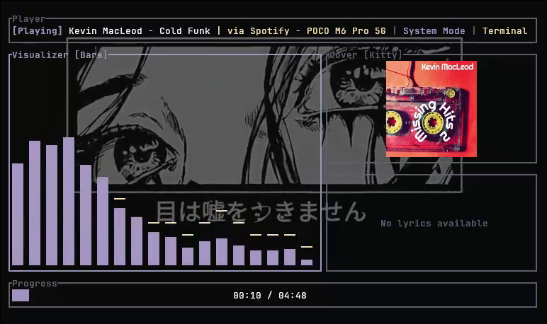

# lyre

lyre is a terminal music player and audio spectrum visualizer written in Rust. It plays local tracks or monitors active system audio via MPRIS D-Bus, syncs LRC lyrics, and renders album art with Kitty graphics or half-block pixel art.

## Demo



- [Demo 1: Local file playback, bars visualizer, and lyrics sync](assets/recording_2026-10-16_21-22-13.mp4)
- [Demo 2: MPRIS system capture, oscilloscope mode, and album cover rendering](assets/recording_2026-10-16_21-25-24.mp4)

## Dependencies

Building requires Rust (1.80 or newer), ALSA development headers, and D-Bus development headers.

### Debian / Ubuntu
```bash
sudo apt-get install -y libasound2-dev libdbus-1-dev pkg-config
```

### Arch Linux
```bash
sudo pacman -S --needed alsa-lib dbus pkgconf
```

### Fedora
```bash
sudo dnf install -y alsa-lib-devel dbus-devel pkgconf-pkg-config
```

## Build and Installation

```bash
cargo build --release
```

The compiled binary will be placed at `target/release/lyre`.

## Usage

```bash
# Play a single audio file
./target/release/lyre /path/to/song.flac

# Play all audio files in a directory
./target/release/lyre ~/Music/

# Launch in System MPRIS mode (visualizes desktop audio and tracks active media player)
./target/release/lyre --system
```

When started with no arguments, lyre defaults to System Mode and waits for an active MPRIS media player.

## Keybindings

| Key | Action |
| --- | --- |
| `Space` | Play / Pause |
| `n` / `b` | Next / Previous track |
| `s` | Restart track (or skip in System Mode) |
| `m` | Toggle Local / System Mode |
| `c` | Toggle Album Art (Kitty / Pixel Art / Off) |
| `+` / `-` | Volume up / down (Local Mode) |
| `[` / `]` | Adjust lyrics timing offset (-/+ 100ms) |
| `v` | Cycle visualizer mode (Bars, Spectrum, Oscilloscope, Stereo Wave) |
| `t` | Cycle color theme |
| `Tab` / `p` | Toggle track playlist drawer |
| `j` / `k` or `Down` / `Up` | Select track in drawer |
| `Enter` | Play selected track |
| `?` | Toggle keybindings popup |
| `q` / `Esc` | Quit / Close modal |

## Architecture: Audio Pipeline and FFT

Audio playback and capture run on background threads independent of the terminal render loop.

In Local Mode, the playback thread decodes audio with symphonia and pushes interleaved f32 PCM frames into a ring buffer before writing to the ALSA sink. In System Mode, CPAL opens the default system monitor device and captures live output PCM frames into the same buffer.

At each terminal frame (60 Hz), the UI thread polls the buffer non-blockingly using `try_lock()`. It copies the latest 2048 samples, applies a Hann window to limit spectral leakage, and computes a forward FFT with `rustfft`. Magnitudes are mapped across a logarithmic frequency scale (42 Hz to 16 kHz) with frequency curve equalization, smoothing, and peak decay filters before drawing to the terminal grid.
